# Thread&Co Architecture

Flow-only view of the whole project. Every box is one responsibility, arrows are data or control flow. Diagrams are Mermaid and render on GitHub and in VS Code.

Sections: 1 System map, 2 Backend pipeline, 3 Frontend runtime, 4 Auth and roles, 5 Password reset, 6 Checkout and order, 7 Catalog and variants, 8 Style assistant, 9 Photo search, 10 Size and companion engines, 11 Rate limiting, 12 Data model, 13 Build, test, deploy, 14 Flow breaks.

---

## 1. System map

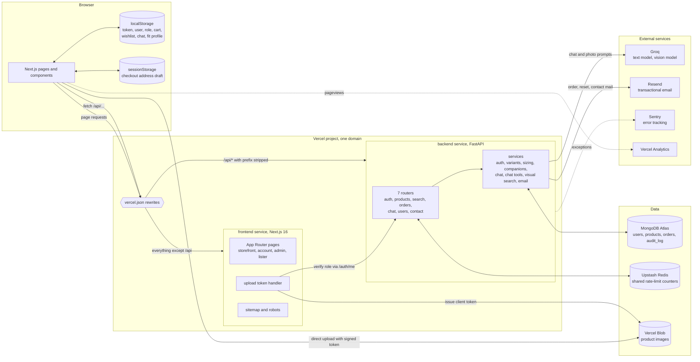

---

## 2. Backend request pipeline

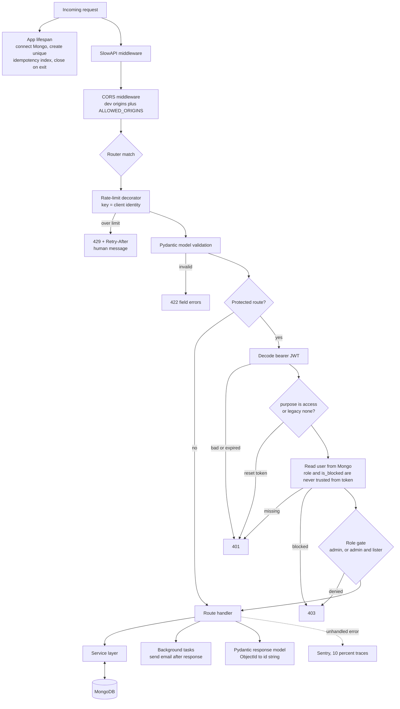

---

## 3. Frontend runtime

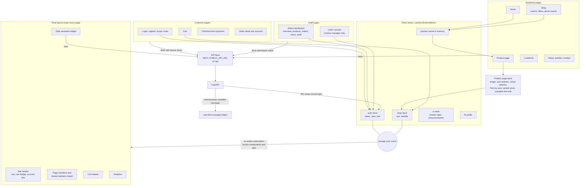

---

## 4. Auth and roles

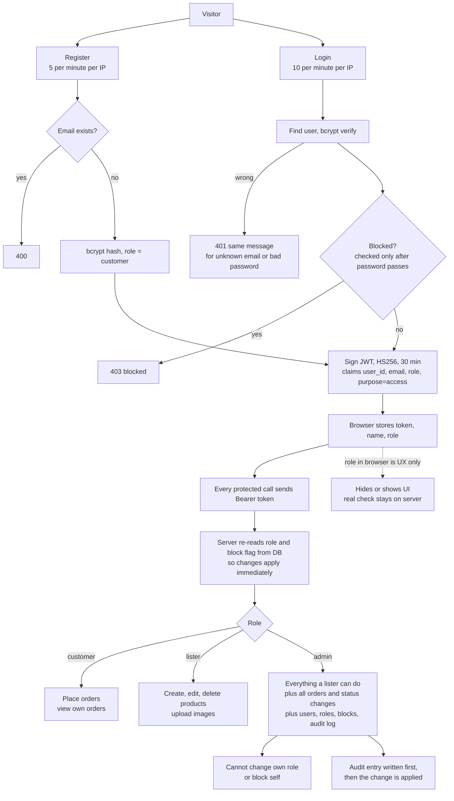

---

## 5. Password reset

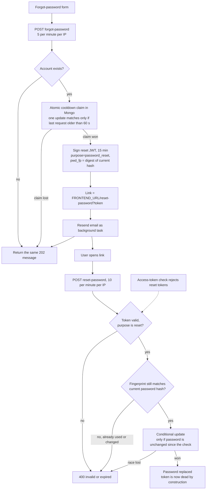

---

## 6. Checkout and order

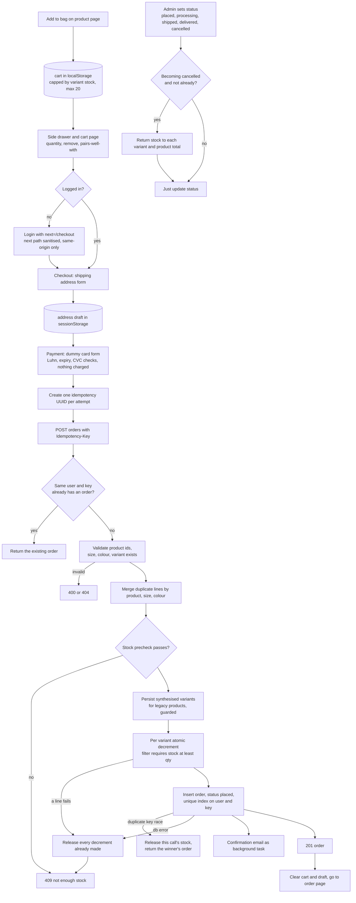

---

## 7. Catalog and variants

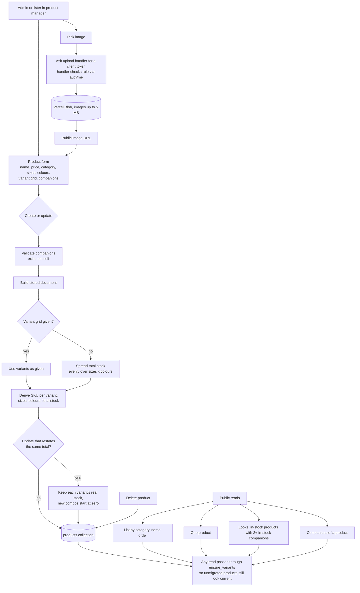

---

## 8. Style assistant

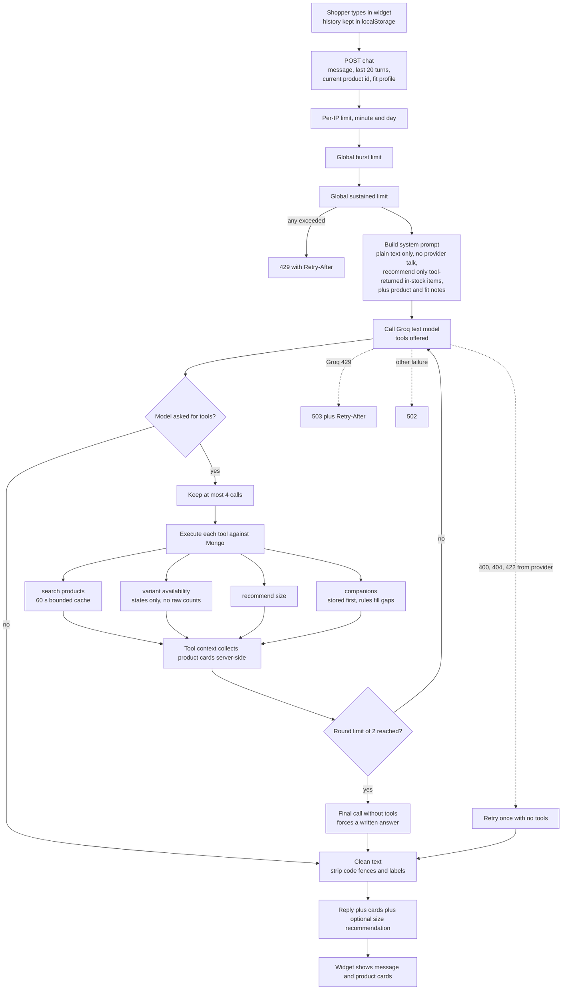

---

## 9. Photo search

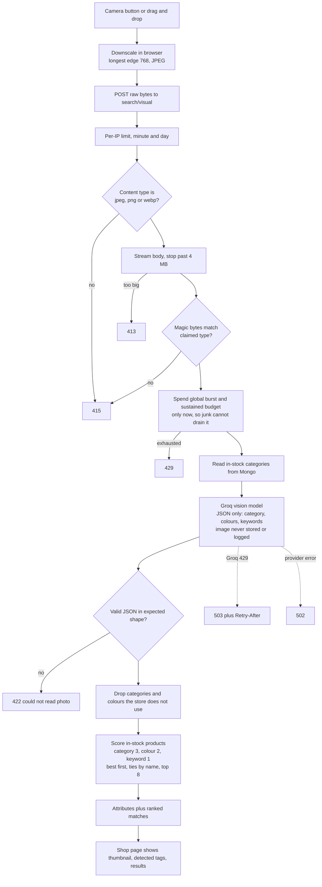

---

## 10. Size and companion engines

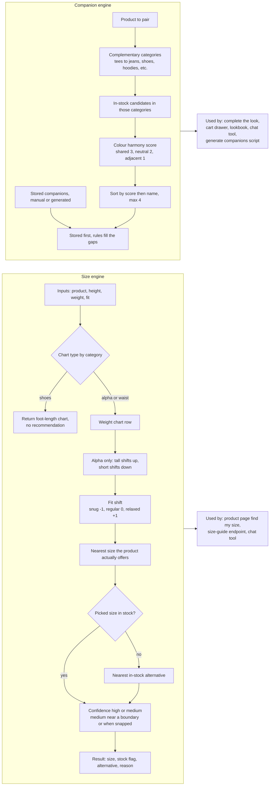

---

## 11. Rate limiting and resilience

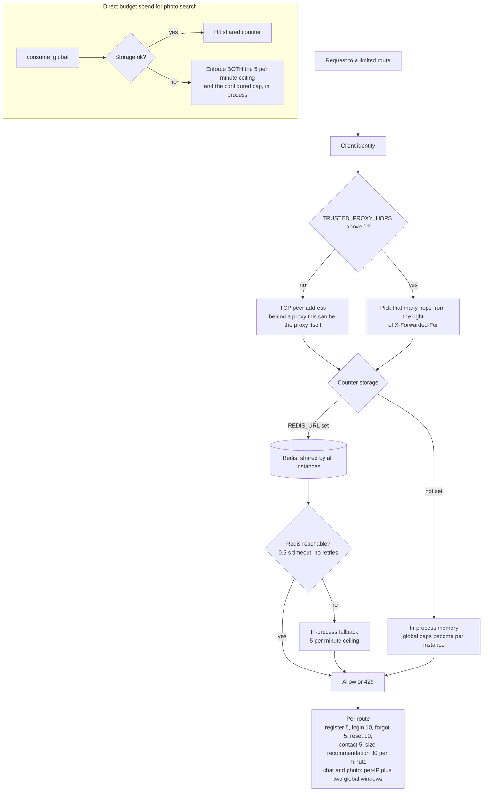

---

## 12. Data model

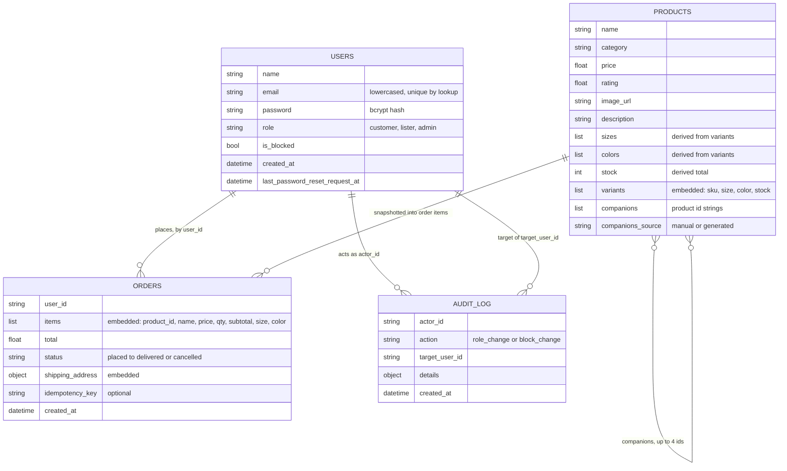

Index: unique partial index on orders by user_id and idempotency_key, only where the key exists.

---

## 13. Build, test, deploy

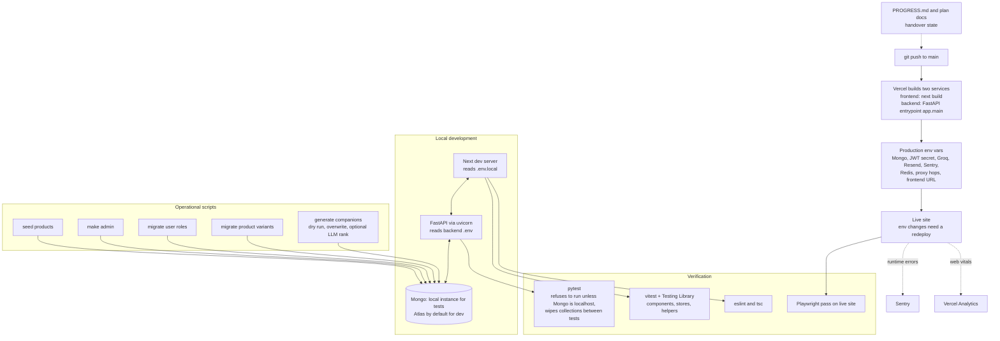

---

## 14. Flow breaks to know about

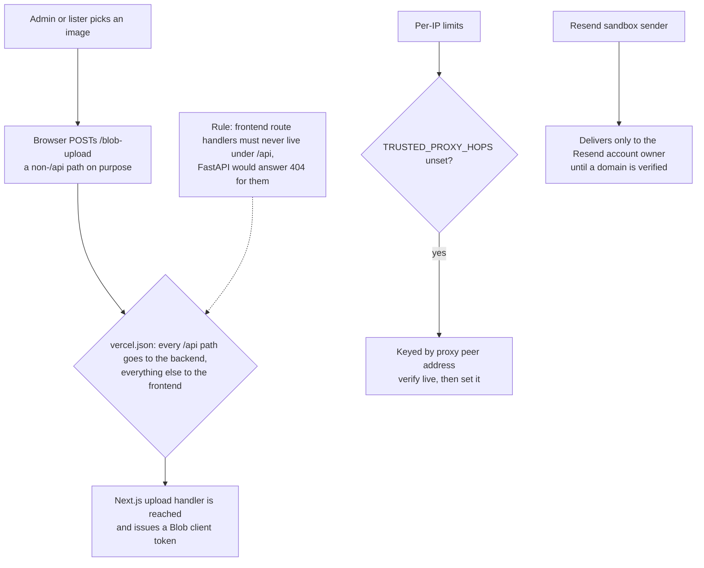
